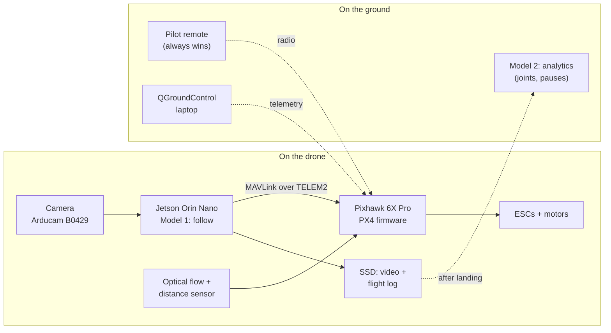
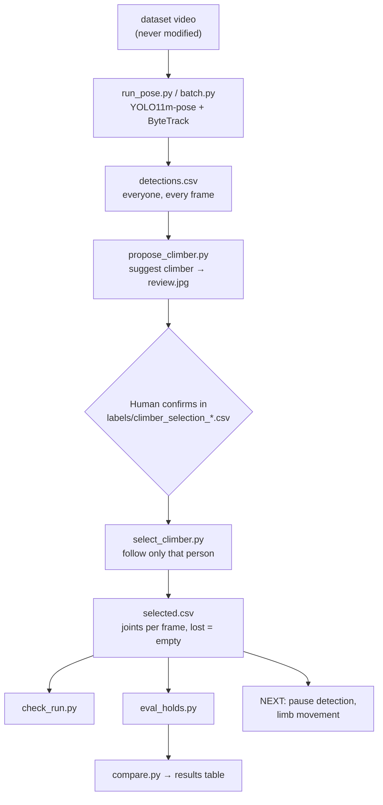
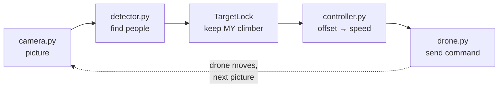

# Wingman – start here

Wingman is a senior design project: a drone that rises with a climber on an indoor
climbing wall, keeps them in frame, and records video; after the climb, software
measures the climber's body (joints) and bookmarks moments worth reviewing.

This file is the map of the code: what each part does, how the parts connect, what is
done, and what is left. It is written for teammates **and** is read automatically by
Claude Code when it works in this folder. Deeper explanations live in `docs/`.

---

## 1. The big picture



| | **Model 1 – live follower** | **Model 2 – after-flight analytics** |
|---|---|---|
| Question | Where is *my* climber in this picture? | What did the climber's body do? |
| Runs on | Jetson, in the air, ~10 times/second | Any laptop, after landing |
| Must be | Fast and never switch people | Accurate |
| Output | Up/down speed command to PX4 | 17 joints per frame → pauses, moves |
| Code | `src/wingman/follow/` | `src/wingman/*.py` |
| Status | Simulated on dataset videos; not on hardware yet | Run on all 22 dataset videos, evaluated |

---

## 2. Folder map

```
wingman/
├── CLAUDE.md                 ← you are here
├── README.md                 setup + commands
├── pyproject.toml            package definition; requirements.lock.txt = exact versions
├── configs/
│   ├── follow.yaml           ALL Model 1 settings (camera, distance, controller, lock rules…)
│   ├── eval.yaml             Model 2 evaluation settings (fixed before results; don't tune)
│   └── bytetrack.yaml        tracker settings (Ultralytics defaults, copied for the record)
├── src/wingman/              ── Model 2: after-flight analytics ──
│   ├── manifest.py           list of the 22 dataset videos (hash, fps, license)
│   ├── run_pose.py           Stage 1: pose model + tracker on a video → every person, every frame
│   ├── batch.py              run_pose on many videos
│   ├── propose_climber.py    suggest the climber per video → human confirms → apply
│   ├── select_climber.py     Stage 2: follow ONE confirmed person; missing frames = "lost"
│   ├── check_run.py          15 automatic consistency checks (PASS/WARN/FAIL)
│   ├── eval_holds.py         joints vs the dataset's own hold-contact labels
│   ├── compare.py            one results table across videos/settings
│   ├── keypoints.py          17 joint names, skeleton drawing
│   ├── video_io.py           video read/write helpers
│   └── follow/               ── Model 1: live follower ──
│       ├── config.py         loads follow.yaml (+ --set overrides)
│       ├── geometry.py       dataset pixels ↔ wall metres (fixes a dataset quirk, see §6)
│       ├── camera.py         SimCamera (drone view rendered from dataset) | LiveCamera (Jetson, untested)
│       ├── detector.py       PersonTracker (YOLO + ByteTrack) and TargetLock (lock rules)
│       ├── controller.py     PID: offset in picture → up/down speed, with limits
│       ├── drone.py          SimDrone (Layer 1) | PX4Drone via MAVSDK (untested)
│       └── run_follow.py     the follow loop + simulation scoring
├── tests/test_follow.py      13 automatic tests (python -m pytest -q)
├── data/manifest.csv         the 22 videos
├── labels/                   HUMAN decisions (climber picks). Never overwrite with model output.
├── outputs/                  results (CSV/JSON in git; videos/images are not)
│   ├── m960/<video>/         Model 2 results per video (selected.csv = the joints to analyse)
│   ├── sim/<run>/<video>/    Model 1 simulation runs
│   └── comparison_*.csv      results tables
└── docs/                     PROGRESS_LOG (what's done, honestly), FILE_GUIDE, CODE_WALKTHROUGH, WALKTHROUGH
```

Not in git: `.venv/` (rebuild from `requirements.lock.txt`), `models/*.pt` (download
automatically), videos and images (shared through the team Drive), the dataset itself
(`~/Downloads/wingman dataset`, from Zenodo record 15196867).

---

## 3. Model 2 – how the analytics pipeline fits together



Commands are in `README.md`. Chosen setting: `yolo11m-pose.pt`, image size 960.

---

## 4. Model 1 – the follow loop



**Two plugs make simulation and reality interchangeable:**
- camera: `SimCamera` (now) ↔ `LiveCamera` (Jetson)
- drone: `SimDrone` (now) ↔ `PX4Drone` (PX4 SITL, then the real Pixhawk)

**Lock rules (`detector.py`)** – the safety-critical part:
1. At start, lock onto the person nearest the image centre (pilot centred them).
2. Follow that track id only. If it disappears → **hold position**.
3. Within 2 s, re-lock only onto someone close to the last position with a similar size.
4. After that → stay holding and ask the pilot. **Never switch to whoever is nearest/largest.**

**Simulation (Layer 1, runs on a Mac):** `run_follow.py` flies `SimDrone` in front of a
dataset climb. `SimCamera` cuts the drone's view out of the dataset frame using real wall
metres (`geometry.py`). Scores use the human-confirmed climber from Model 2 as truth,
**only for scoring, never for decisions**.

**Layer 2 (not set up yet):** PX4 SITL + Gazebo on an Ubuntu machine; `PX4Drone` talks
to it unchanged. Do not install it on a nearly full laptop.

---

## 5. Settings

Everything adjustable for Model 1 is in `configs/follow.yaml`, each with a unit and a
note when the value is a guess. Try a change without editing the file:

```bash
.venv/bin/python -m wingman.follow.run_follow --videos p4_orange --set controller.kp=1.2 --name kp12
```

Expensive to change later (decide deliberately): PX4 vs other firmware, fixed camera vs
motorised gimbal (the sim assumes a fixed camera facing the wall), camera connection,
Jetson model, "elevator mode" (up/down only) vs free following.

---

## 6. Conventions and known quirks

- **Coordinates:** image pixels have (0,0) at the top-left, y grows downward. Wall
  coordinates are metres, y grows upward. Speeds: positive = up.
- **Time:** use timestamps in seconds, not frame counts, for anything about duration.
- **Missing is missing:** a frame where the climber isn't found is `lost` with empty
  joints. Never fill gaps; a filled gap looks like a perfectly still climber.
- **Humans pick the climber.** Model output only *suggests*; `labels/` holds decisions.
- **Fair testing:** Model 2 was chosen on climbers p1, p3, p5 (development). p2, p4, p6,
  p7, p8, p9, p10 are held out. Model 1 settings were tuned on p4_orange and p5_orange.
  Report results on data not used for tuning separately.
- **Dataset quirk:** in most `*_bolt_holes.json` files the two top reference points are
  in reversed left/right order, which breaks the provided homography. `geometry.WallMap`
  pairs points row by row and refits. Climber sizes come out plausible, not verified.
- **License:** dataset is CC BY 4.0 – credit "The Way Up" (Zenodo 15196867) wherever
  footage or derived results are shown. Ultralytics is AGPL-3.0 (fine for coursework;
  check before any commercial use).

---

## 7. Status (2026-11-23) and what's left

| Area | Done | Left |
|---|---|---|
| Model 2 analytics | Pose + tracking on 22 videos; human-confirmed climbers; held-out hands 97.8%, feet 81.6% at labelled holds | Pause detector; limb-movement / readjustment detection; investigate weak feet (p8_orange, p9_green); hand-label pauses on held-out videos **before** running the detector |
| Model 1 follower | Settings file, sim camera + drone, lock rules, controller, 13 tests; sim on 20 untuned videos: climber fully in frame median 100%, 0 wrong-person locks, but "needs pilot" stops in 10/20 (partly a sim blur artifact, see PROGRESS_LOG) | Tune controller; set up PX4 SITL (Ubuntu); test `PX4Drone`; Jetson: JetPack, TensorRT, measured fps; `LiveCamera` with the real B0429 |
| Hardware (ESE) | Parts chosen, wiring diagram | Indoor hover with optical flow; camera lens / field of view; Jetson power and mounting; PX4 failsafe settings |
| Integration | — | Props-off bench tests; handheld dry run; tethered and free flights; gym tests |

Honest numbers and their limits are in `docs/PROGRESS_LOG.md`. Don't quote a number
that isn't there.

---

## 8. Working on this repo (people and Claude)

- Explain the plan before changing code; keep changes small and in the existing style.
- Run `python -m pytest -q` and `python -m wingman.check_run --run <folder>` after changes.
- Never present simulated, proposed or guessed values as measured results.
- Don't commit or push without the project owner's OK; don't commit videos or the dataset.
- Update `docs/PROGRESS_LOG.md` when something is run or verified.

## 9. Glossary

| Term | Plain meaning |
|---|---|
| Pose model / keypoints | AI that finds 17 body joints in a picture |
| Track id / ByteTrack | number given to a person so they stay "the same person" across frames |
| PX4 / Pixhawk | flight software / the flight-controller board that keeps the drone stable |
| MAVLink / MAVSDK | the language Jetson ↔ Pixhawk speak / Python library for it |
| Offboard mode | PX4 mode that obeys commands from the Jetson |
| Failsafe | automatic safe reaction (e.g. hold) when something stops working |
| SITL / Gazebo | PX4 running on a computer / 3D simulated world for it |
| PID controller | formula turning "how far off" into a smooth correction |
| TensorRT / JetPack | NVIDIA tool to make models fast / the Jetson's operating system |
| Homography | 3×3 matrix mapping one flat plane (image) onto another (wall) |
